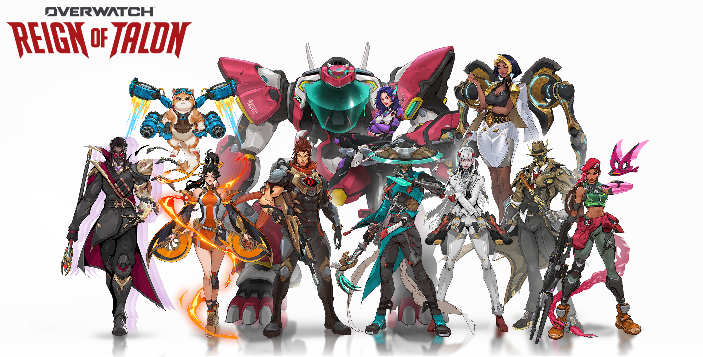
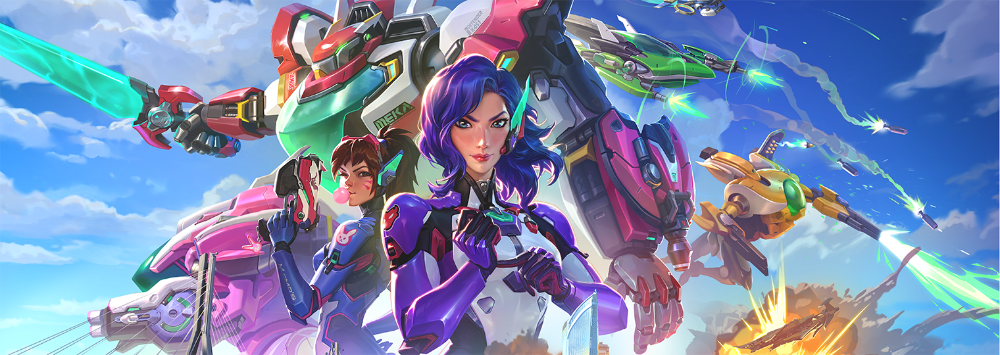
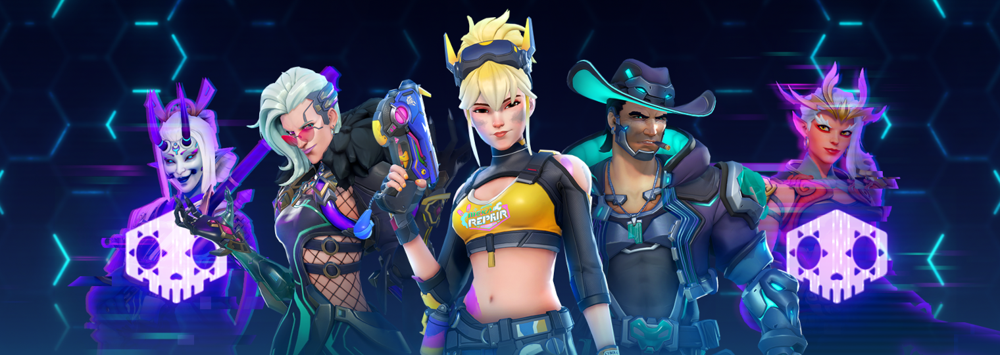
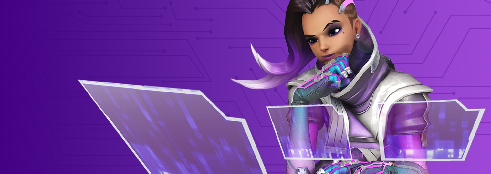
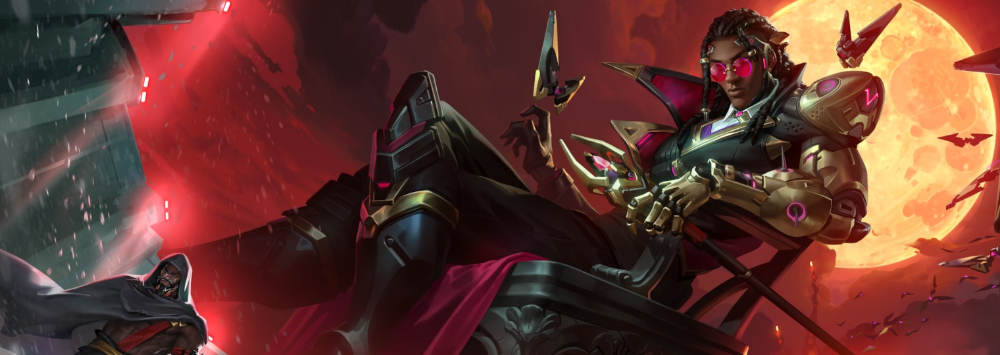
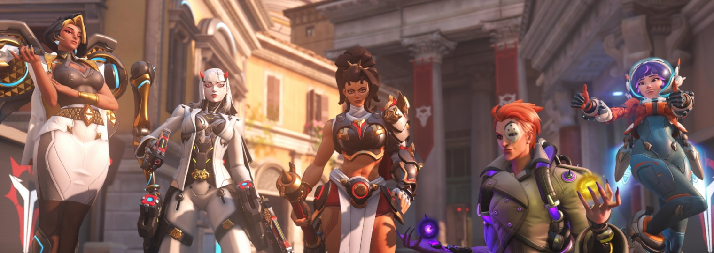
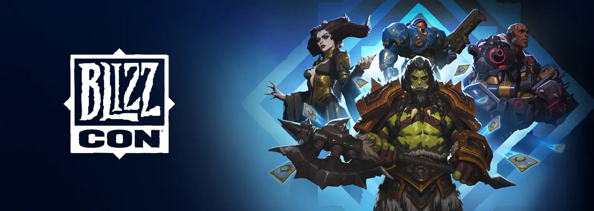
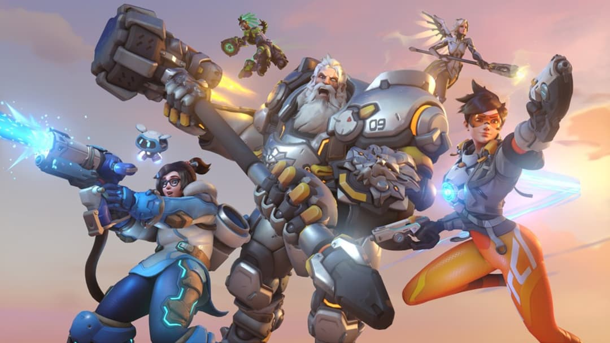

**Сформировано:** 03.11.2026 05:27 UTC · стартовый срез · найдено всего: 197

### Главное
- [Overwatch’s Director Explains Why The Same Few Heroes Keep Getting Skins - Kotaku](https://news.google.com/rss/articles/CBMiiAFBVV95cUxPVkV5TnhuTFc2LXpmLUZNS2Q1cXpXRUZoakZRWE03V2FkU3FLT3RMUXNmQnV2OG9ZUjVEQVNKblpMdjBPSU1RQVNGZmdEMjhSNWtXcXJjc1BFbkQ0UFBHM0hlRFFpY3NJaDQyWDJobWNDLUpsREU2MkxGMFF2dXY2Z1VQbzA3bXJM?oc=5)
- [Overwatch Director says PvE could return but full campaign would need a “whole new game”](https://www.dexerto.com/overwatch/overwatch-director-says-pve-could-return-but-full-campaign-would-need-a-whole-new-game-3423940/)
- [Sink your teeth into Overwatch's BlizzCon Reveals!](https://news.blizzard.com/en-us/article/24294376/sink-your-teeth-into-overwatch-s-blizzcon-reveals)

## 🆕 Герои

### [Sink your teeth into Overwatch's BlizzCon Reveals!](https://news.blizzard.com/en-us/article/24294376/sink-your-teeth-into-overwatch-s-blizzcon-reveals)
Overwatch brings a new Hero, map, musical performances, esports, and more to BlizzCon 2026!

`Blizzard` · 12.09.2026

### [Reign of Talon – Season 4: Heroes of Busan Brings Out the Best](https://news.blizzard.com/en-us/article/24295381/reign-of-talon-season-4-heroes-of-busan-brings-out-the-best)
D.Mon enters the fight as the newest Tank Hero to defend Busan in a season built to bring out the Hero in each other on the battlefield!

`Blizzard` · 10.08.2026

## 🎨 Скины и косметика

### [Overwatch’s Director Explains Why The Same Few Heroes Keep Getting Skins - Kotaku](https://news.google.com/rss/articles/CBMiiAFBVV95cUxPVkV5TnhuTFc2LXpmLUZNS2Q1cXpXRUZoakZRWE03V2FkU3FLT3RMUXNmQnV2OG9ZUjVEQVNKblpMdjBPSU1RQVNGZmdEMjhSNWtXcXJjc1BFbkQ0UFBHM0hlRFFpY3NJaDQyWDJobWNDLUpsREU2MkxGMFF2dXY2Z1VQbzA3bXJM?oc=5)
Overwatch’s Director Explains Why The Same Few Heroes Keep Getting Skins Kotaku

`Google News` · 02.11.2026

### [All Overwatch collaborations and crossover skins (full list 2026) - Esports.gg](https://news.google.com/rss/articles/CBMijgFBVV95cUxNejVMSkVZVDhlaURfbjU0WWxFUVFFNU5yMzBWUWVmVFdOY2RWbFlZRE01OTVDOVVDN2V5TDVydmtGSkNNQnJzMnpyUjJfd2ROM21jYmVqR0J5UkdVWEh2ZzhfSzFlR05vUkl6N3JuSlQ5ZFFsM2FoYk4zc2M1a0VQd250d0RSaGFDNjlWODJR?oc=5)
All Overwatch collaborations and crossover skins (full list 2026) Esports.gg

`Google News` · 25.10.2026

### [Director's Take: Battle Pass Revamp](https://news.blizzard.com/en-us/article/24296053/director-s-take-battle-pass-revamp)
Your seasonal adventures just got a personalized upgrade! Join Game Director Aaron Keller and Product Director Chris McCabe for a crash course on the new Battle Pass system.

`Blizzard` · 10.08.2026

### [The Heat Is On in Reign of Talon - Season 3 Midcycle](https://news.blizzard.com/en-us/article/24290434/the-heat-is-on-in-reign-of-talon-season-3-midcycle)
Summer Games return, Quick Play Hacked experiments begin, plus Mythic Mauga forges a world full of sizzling rewards and more!

`Blizzard` · 14.07.2026

## 📅 Сезоны, события, патчи

### [Overwatch Season 5 Team Drives: All rewards, Fame bonuses, and more - Esports.gg](https://news.google.com/rss/articles/CBMioAFBVV95cUxQV19BWm5yeENIOUtVT0VKNGxtb0I5ZENwX2RYbmpsbk1VOW9mYjlCT3Z5bDZkTTdyQ0lNcHBDb3RhSGNqeHd4NEN1djMyQ3NWNllQMXpDRldPUjk5RTdsSzhwT2tnUXRTZ1FtazRLLXgwWVJBYnRlNF9jZWJpTGtGSVVGcDBfUFJ5NTVIejgwRTRPeTc3N1FveVoycGxOOWJv?oc=5)
Overwatch Season 5 Team Drives: All rewards, Fame bonuses, and more Esports.gg

`Google News` · 30.10.2026

### [Feed Your Hunger in Reign of Talon – Season 5: A Grim Doctrine](https://news.blizzard.com/en-us/article/24303008/feed-your-hunger-in-reign-of-talon-season-5-a-grim-doctrine)
Doctrine emerges from the frozen depths of Grímsvötn as Halloween madness rises from the grave, and the Reign of Talon races toward its thrilling conclusion.

`Blizzard` · 05.10.2026

### [Season 4 Midcycle Takes You To The BlizzCon Stage!](https://news.blizzard.com/en-us/article/24295392/season-4-midcycle-takes-you-to-the-blizzcon-stage)
We come together in Team Drives and at BlizzCon for the Overwatch World Cup, Team 4 panels, QuestWatch, and more.

`Blizzard` · 04.09.2026

### [Celebrate BlizzCon® 2026 With a Hoard of In-game Items](https://news.blizzard.com/en-us/article/24272113/celebrate-blizzcon-2026-with-a-hoard-of-in-game-items)
Shop the BlizzCon Digital Bundles on Battle.net, available now through September 28.

`Blizzard` · 22.07.2026

## 📰 Прочие новости

### [Overwatch Director says PvE could return but full campaign would need a “whole new game”](https://www.dexerto.com/overwatch/overwatch-director-says-pve-could-return-but-full-campaign-would-need-a-whole-new-game-3423940/)
Overwatch Game Director Aaron Keller has opened the door to PvE story missions returning, but doing so could require an entirely new game.

`Dexerto` · 02.11.2026

### [Overwatch Might Get More Small PvE Experiences, Campaign Would Need “a Whole New Game” - GamingBolt](https://news.google.com/rss/articles/CBMiqgFBVV95cUxOYlVpdFA4YXBKSUlhakR0X09Ta09fQVdpeWpmR1E4dmVkQUJJMjU3UFd1YWJvalVTUUgzT1FaeXFqdFdxYzdNaGY4a25FUXdwMU5la0hUb0pieE9rd04xZWJiMkRxYTM4MTM3OS1abDRiNmhlQTNCaFBoZTZqTEhvdmZHQXVLai1FLTAtNTFxZjNieEFNc2xMM1dFb2V2c3NqS1p6LWl1a19XZw?oc=5)
Overwatch Might Get More Small PvE Experiences, Campaign Would Need “a Whole New Game” GamingBolt

`Google News` · 02.11.2026

### [Overwatch director "would never discount" the return of PvE content, but another story-driven campaign would need a "whole new game" - GamesRadar+](https://news.google.com/rss/articles/CBMi-AFBVV95cUxOZ1BJRzZSaC0tSUQyTDRadENKbll4bG93R1o1bU1ZS1gtZkhQbXFUT2RkcFhwZjcxYzRDV0VjaWdVbDk2THBhV3BXd0hkQnVVckxUa3k0eTd3ak9ITGVqM0FRenFhVXdsckZpd2NoMUFWVlU2RG45Y3M5UVRyV2lmdGlBLUlyUURMSENmTE9VaV9KQmIzWUNPSTh3cDAtNFhPaFVob3NKT2g0UGxlWXpoMU9iNFRRWXh4RnFadEJ6UHdaOXhWT1hSeGpRZ1J0MVQ3SEVBY29PS3NwV0ZXOGpJS2JvbnppMmZkT3Qzc0taODVyeDY0WnRxWA?oc=5)
Overwatch director "would never discount" the return of PvE content, but another story-driven campaign would need a "whole new game" GamesRadar+

`Google News` · 01.11.2026

### [Team Liquid VS Spacestation Gaming ➥ Overwatch ➥ Betting Tips, Stream, LiveScore, Results on EGW☕ - EGamersWorld](https://news.google.com/rss/articles/CBMimwFBVV95cUxPekVnemhrczBQRUpTLW51aGlTQ3B1Q3YwM1NYQTNjRml4Zm5RUTJSb3U5TElmVGRoWUM3d3dJMzRxdU04ZXd2NW1mRTl3VDdTc0RVSFoxME5WeTUxbnJGVXlLR0xLSWt6TXd1ZDhseldiZFQ5RUxNaGdZUnFVWjVGQlRhRmRvaVVybkpzbTBtQ3lncmlKckpIQnJhUQ?oc=5)
Team Liquid VS Spacestation Gaming ➥ Overwatch ➥ Betting Tips, Stream, LiveScore, Results on EGW☕ EGamersWorld

`Google News` · 01.11.2026

### [Winston’s copypasta fever might be my favorite celebration of Overwatch - Yahoo Tech](https://news.google.com/rss/articles/CBMilwFBVV95cUxOYzJPTUx6aVFhRzYxcl9qanZZNG1oeWpRaW5waFFlSFZYQlcwZE00S2ZoYk13MnctaXJJbFV5UWx5MFR4WnhfNTEwVlRCWXBvODhRZ2FwOTVDcU1YbWNrTFBLV2xOTE1oZGthVHo3WnA2Q1ROSVZtOUxyQUJpZnpsQk9DMmFySGk4d1A5TWtBWkRtSm43VWlR?oc=5)
Winston’s copypasta fever might be my favorite celebration of Overwatch Yahoo Tech

`Google News` · 26.10.2026

🤖 Собирается автоматически · архив: `digests/`
