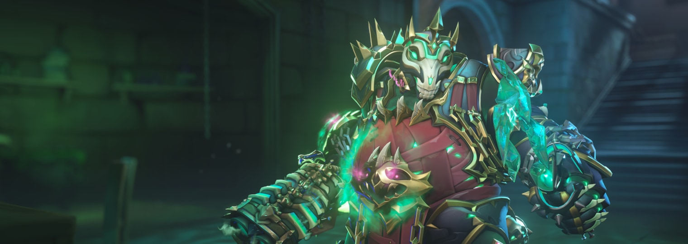
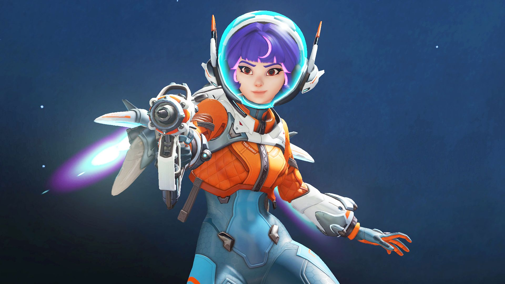

**Сформировано:** 03.11.2026 22:59 UTC · новых материалов: 8 · найдено всего: 198

### Главное
- [Reign of Talon – S5 Midcycle Sets Up the Showdown](https://news.blizzard.com/en-us/article/24303010/reign-of-talon-s5-midcycle-sets-up-the-showdown)
- ['Overwatch’s New Mythic Skin Shows Blizzard Is Finally Shaking Things Up - Polygon.com](https://news.google.com/rss/articles/CBMiiAFBVV95cUxNZldjdnpOaTVIV01senpJdmpoTVJJSXFRT3MxakQ2MEtpOWVWSlRBaXJnb00yeFVNRlcyZUduME8tLUlvbTVLMERjYlJIcjNmZ1RzaEtXYmxHcE1hVFV6Q0lxcEtyWU41OVd0aFV2MGFQOHNMMVFoaVhOVmNKRnk1dy15WWpFSEFp?oc=5)
- [The Overwatch devs hear your complaints about skin distribution but concede that some cosmetics need to 'support the actual bottom-line business'](https://www.pcgamer.com/games/fps/the-overwatch-devs-hear-your-complaints-about-skin-distribution-but-concede-that-some-cosmetics-need-to-support-the-actual-bottom-line-business/)

## 🎨 Скины и косметика

### [Reign of Talon – S5 Midcycle Sets Up the Showdown](https://news.blizzard.com/en-us/article/24303010/reign-of-talon-s5-midcycle-sets-up-the-showdown)
Settle the score with Vendetta as the Reign of Talon reaches its finale, suit up for Overwatch x EVE Protocol, become Mythic Necrotic Knight Roadhog, and dig into everything still lurking in Season 5.

`Blizzard` · 03.11.2026

### ['Overwatch’s New Mythic Skin Shows Blizzard Is Finally Shaking Things Up - Polygon.com](https://news.google.com/rss/articles/CBMiiAFBVV95cUxNZldjdnpOaTVIV01senpJdmpoTVJJSXFRT3MxakQ2MEtpOWVWSlRBaXJnb00yeFVNRlcyZUduME8tLUlvbTVLMERjYlJIcjNmZ1RzaEtXYmxHcE1hVFV6Q0lxcEtyWU41OVd0aFV2MGFQOHNMMVFoaVhOVmNKRnk1dy15WWpFSEFp?oc=5)
'Overwatch’s New Mythic Skin Shows Blizzard Is Finally Shaking Things Up Polygon.com

`Google News` · 03.11.2026

### [The Overwatch devs hear your complaints about skin distribution but concede that some cosmetics need to 'support the actual bottom-line business'](https://www.pcgamer.com/games/fps/the-overwatch-devs-hear-your-complaints-about-skin-distribution-but-concede-that-some-cosmetics-need-to-support-the-actual-bottom-line-business/)
It's rough out here for Zarya fans.

`PC Gamer` · 03.11.2026

## 📅 Сезоны, события, патчи

### [Overwatch Mid-Season 5 Patch Notes Released With Big Tweaks - Polygon.com](https://news.google.com/rss/articles/CBMikAFBVV95cUxPaEgzRzZRb0haUzdJUUN5LVZJVWItNzBFWDZJMi1Td010Q3dOdlZrRGlHMUhvMWZKNUJtTzZmVTkzQ2ZNOEFNWVkzVjNscEh6WUpXQ3RxRWNhMXFkbnVBelVHX1V0ZjdvRTVkdUNuZkZRUll1UjB2RFRLWER0S3BqdFhjMnE1OWFiQ0ZISWJmaHY?oc=5)
Overwatch Mid-Season 5 Patch Notes Released With Big Tweaks Polygon.com

`Google News` · 03.11.2026

## 📰 Прочие новости

### [Overwatch 2 Update 4.40 \| 1.000.105 Released on November 3 - MP1st](https://news.google.com/rss/articles/CBMiogFBVV95cUxQbkVKbE9JcEdaZnRuRE95LVFUQjBMWGhjeDBBZFpsaFMxaGhOdFhxZmlvcjA0MVpqWUt4QWFXQlViSk9NUGFRWTJkMjhGN2NETmNxSDdZWUVITVpNMmt1aFhFakVldzhZQnE3Ykd5UlNMVnhTN3RhcnAwTjM3ZTByUGEwZnh6bU5JWWVGeEU2RVNBdm5NUWVhYjZDNjlPd3ZQcFE?oc=5)
Overwatch 2 Update 4.40 \| 1.000.105 Released on November 3 MP1st

`Google News` · 03.11.2026

### [Reign of Talon – S5 Midcycle Sets Up the Showdown - Blizzard Entertainment](https://news.google.com/rss/articles/CBMioAFBVV95cUxPQ055Y0RfX2NLYkNKaXlTZi1DUzhsdGRCcWZseFZZc0NZbUVBUW9Camg1RHFEOUtNamxQTmdTS2RzbkN2b3dxcml4Qi1NN1htcGFhenhrcHJwY3NhMFVpWmtyWlJZVFZlNXZuSXdYUkN1YWI2bWw2M0ZjbzFPcmIzcnZXQ01jQU96QV9aUHgxZTNFVkJhYS10aTRjcWVsZFYx?oc=5)
Reign of Talon – S5 Midcycle Sets Up the Showdown Blizzard Entertainment

`Google News` · 03.11.2026

### [Overwatch and Stellar Blade are bringing two gaming worlds together - lnt.ma](https://news.google.com/rss/articles/CBMiiwFBVV95cUxPY0tZcjlzNmJVUHFwVk5Oa2JseEF3Q21BdmM3SHBXWFRjemNWcjZCbDM4V0ktMmZKSDJybGVXLVJ5UGlzT2FCLXJEaW1Yb1lSSnkzOUF1X2g5T1hSdXI3MU9LbHp1Qk9LLThyVWtFczQybWMySU4xeVUtaTJUbGpwbnZzRjV3TUstX2VN?oc=5)
Overwatch and Stellar Blade are bringing two gaming worlds together lnt.ma

`Google News` · 03.11.2026

### [Overwatch's Director Addresses The Possibility Of PvE Story Missions Returning - TheGamer](https://news.google.com/rss/articles/CBMic0FVX3lxTFBqUkg1blhtZVJIYUVNTnZLZDMyelhQMEF2WVN4Q3VRdExWUWlhc0NNNzB1Nm05SGY4dFFHODA1Rkdhb3Y3eU14bFdlUG9pQWxwZmhvZy1kdWh6NFFMbGRjZWhaZk5QRlQwV0Jlei1XeFZzcVU?oc=5)
Overwatch's Director Addresses The Possibility Of PvE Story Missions Returning TheGamer

`Google News` · 31.10.2026

🤖 Собирается автоматически · архив: `digests/`
