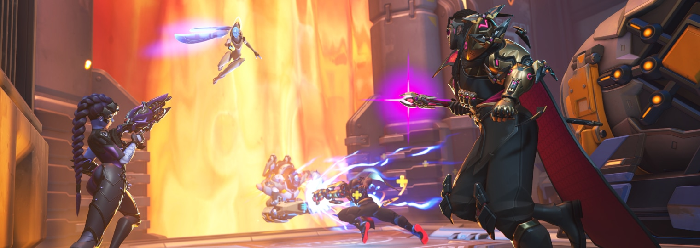

**Сформировано:** 10.11.2026 22:57 UTC · новых материалов: 6 · найдено всего: 156

### Главное
- [Director’s Take: 5v5 and 6v6, Better Together](https://news.blizzard.com/en-us/article/24316733/directors-take-5v5-and-6v6-better-together)
- [Overwatch brings back 6v6 Role Queue for a four-week Competitive test in Season 6 - Inven Global](https://news.google.com/rss/articles/CBMiwgFBVV95cUxOVFFXQ1R2UXNXdmhad0F2cHFUVFM0UDVEVDNvVVA5X3o2S3lXNjhnZ3lPTTluVjdqTllETEhTSWpmMEd4VUhVZ2VQVzBOZGxYZGpVZEdFQU1kemR5cnM5T1NQYWN6c3BKTjdoY1VDR3R6Tmd0V1BVTVBUSXYtbS03UERaNlFIS1phTHpfLXpwdXBRQnlrMGZIQU42aVk5UmZKRDQxQ2Q1MTRtQ2pwSURmdjNjeUdMelpDbk5LYjBLWmJ0dw?oc=5)
- [Overwatch Brings Back 6v6 Role Queue in a Four-Week Competitive Mini Season for Season 6 - TalkEsport](https://news.google.com/rss/articles/CBMimAFBVV95cUxNRm1aaVl0Rk4zeVpmVDNSeGdVZ0JldzZRa2M3dDN5eXAzVHN5ZnVGcUVNazRnSU5HVGpHcGZvX2N5SDlVMk4yLTcxdW9OdWppTkM0Wmt2Z0xrUkxsMW13dlVhLU9VY2RNLTlqWVNETnRpVEVIWGFJUTh4R3V5UHZjdHlydUNWN2VIZ1RCM3ltTUpEdzR6cTFERg?oc=5)

## 📅 Сезоны, события, патчи

### [Overwatch brings back 6v6 Role Queue for a four-week Competitive test in Season 6 - Inven Global](https://news.google.com/rss/articles/CBMiwgFBVV95cUxOVFFXQ1R2UXNXdmhad0F2cHFUVFM0UDVEVDNvVVA5X3o2S3lXNjhnZ3lPTTluVjdqTllETEhTSWpmMEd4VUhVZ2VQVzBOZGxYZGpVZEdFQU1kemR5cnM5T1NQYWN6c3BKTjdoY1VDR3R6Tmd0V1BVTVBUSXYtbS03UERaNlFIS1phTHpfLXpwdXBRQnlrMGZIQU42aVk5UmZKRDQxQ2Q1MTRtQ2pwSURmdjNjeUdMelpDbk5LYjBLWmJ0dw?oc=5)
Overwatch brings back 6v6 Role Queue for a four-week Competitive test in Season 6 Inven Global

`Google News` · 10.11.2026

### [Overwatch Brings Back 6v6 Role Queue in a Four-Week Competitive Mini Season for Season 6 - TalkEsport](https://news.google.com/rss/articles/CBMimAFBVV95cUxNRm1aaVl0Rk4zeVpmVDNSeGdVZ0JldzZRa2M3dDN5eXAzVHN5ZnVGcUVNazRnSU5HVGpHcGZvX2N5SDlVMk4yLTcxdW9OdWppTkM0Wmt2Z0xrUkxsMW13dlVhLU9VY2RNLTlqWVNETnRpVEVIWGFJUTh4R3V5UHZjdHlydUNWN2VIZ1RCM3ltTUpEdzR6cTFERg?oc=5)
Overwatch Brings Back 6v6 Role Queue in a Four-Week Competitive Mini Season for Season 6 TalkEsport

`Google News` · 10.11.2026

## 📰 Прочие новости

### [Director’s Take: 5v5 and 6v6, Better Together](https://news.blizzard.com/en-us/article/24316733/directors-take-5v5-and-6v6-better-together)
Two roads diverged in the Overwatch community… you should probably travel both. Game Director Aaron Keller returns with an update on the state of 5v5 and 6v6 as the Reign of Talon comes to an end.

`Blizzard` · 10.11.2026

### [Overwatch brings back 6v6 role-queue following player feedback - Video Games Chronicle](https://news.google.com/rss/articles/CBMipwFBVV95cUxNUGNUZ3NIb1dJNTVHcGZ0MGhIQ0V6R0RFajdZNnBMS2ZHOXJua3dFcXRUMk5PQXBTUVlSSlRVU1VSM3JJbnVnTXJnT2R1SDF1R3YzRHg0LW9TaGY4SFZ2aS1YTTQ1RVllTXFUbE9hS0R5NmlIRDZ0TXdmTDBJYWhjQ1BYQmRKOGd0S01naHd2Y3JVbHFYc2ExQ1hhR1lXRjNjLURBal9fYw?oc=5)
Overwatch brings back 6v6 role-queue following player feedback Video Games Chronicle

`Google News` · 10.11.2026

### [Director’s Take: 5v5 and 6v6, Better Together - Blizzard Entertainment](https://news.google.com/rss/articles/CBMimgFBVV95cUxPQ01oUW9WTkNCYVpuNk11Z3J1SEt1b0E0UDBmU01CLUlYUUhEQTVEcWlhd0x3T1R0ZUVOeUVEVExVWndMdzFqMDBxMG01aktuNklPcXpRcXB2WUdLZjIzUG5YSjZKUGpXQnlaMVJ0OXRfbHZ4QzFLZjFBSG10bjhGNURwY2oxckJYaGJXR3dETUNjY3RXYUw2amdR?oc=5)
Director’s Take: 5v5 and 6v6, Better Together Blizzard Entertainment

`Google News` · 10.11.2026

### [Overwatch Hero List: All 54 Heroes by Role and Sub-Role - The Loadout](https://news.google.com/rss/articles/CBMiV0FVX3lxTE9GbWdFM09DbkpnRVpNc0N3a3BOUWpSdkxxQTd0YnhiQlhvVlM3bW9ldzFyV2Y1aU9XQTF1cDFLNzU2ZHhJUmkzWlVQYVVESlZaOXNCZ1RxSQ?oc=5)
Overwatch Hero List: All 54 Heroes by Role and Sub-Role The Loadout

`Google News` · 10.11.2026

🤖 Собирается автоматически · архив: `digests/`
