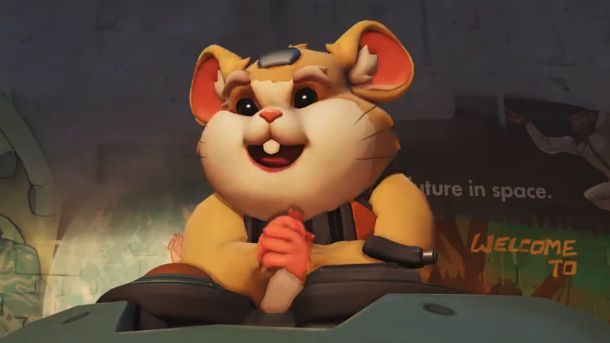

**Сформировано:** 12.11.2026 00:13 UTC · новых материалов: 5 · найдено всего: 159

### Главное
- [Overwatch Season 6 hero reveal set for OWCS World Finals 2026 - Esports.gg](https://news.google.com/rss/articles/CBMinAFBVV95cUxPcmtuWXFuN21GODRvY3BvMDB5T2RHUEtIcVpiamQ2SzVqTWJuSDlyYVpPTDQ5YzA1VXNzcjh2YU04N3Rab2VvLTIxQXV5QUVJN0JKVmZXcmtmU0FVSldxWFdPQUIxbWFoRVd3SW53UFJiYzVraTJCeWpIR0Y5Vjc4RzhuRU8ybklrTjlSMjN1VUE2UzZoUnlDQVp4YTQ?oc=5)
- [Overwatch Dream City Skins Cost 1,900 Coins Each in the Shop - Happy Gamer](https://news.google.com/rss/articles/CBMid0FVX3lxTE9WWmpCRkFKX2d1c3FNX3lxem1SaWhpQklaZnpJM19jbWZiM2puSFZlMl90OElyNHQ2OE9sUWZQOHFzZkZIc25WU2ozVWowd190dWVhS0hYQWtzNS1uZURTSmc3UUstZUx6bU15cVA4OExiclh1YVV3?oc=5)
- [Overwatch is bringing back 6v6 Role Queue in Season 6 - GGRecon](https://news.google.com/rss/articles/CBMidkFVX3lxTFAxbFVWVGo0QTVKZjJQNWZwbF8tdk9oMWJSQTdxSGhQbDJnN0xCQmlqYWVEUDRLRk94Q05TMXhrRHpmeTF3ZkVYZVp0bURvRUJScFVEcklUWjh2bGplb0F2LW9Ib2ZHTU1zMFBibGVBNlhNYXlkbXc?oc=5)

## 🆕 Герои

### [Overwatch Season 6 hero reveal set for OWCS World Finals 2026 - Esports.gg](https://news.google.com/rss/articles/CBMinAFBVV95cUxPcmtuWXFuN21GODRvY3BvMDB5T2RHUEtIcVpiamQ2SzVqTWJuSDlyYVpPTDQ5YzA1VXNzcjh2YU04N3Rab2VvLTIxQXV5QUVJN0JKVmZXcmtmU0FVSldxWFdPQUIxbWFoRVd3SW53UFJiYzVraTJCeWpIR0Y5Vjc4RzhuRU8ybklrTjlSMjN1VUE2UzZoUnlDQVp4YTQ?oc=5)
Overwatch Season 6 hero reveal set for OWCS World Finals 2026 Esports.gg

`Google News` · 10.11.2026

## 🎨 Скины и косметика

### [Overwatch Dream City Skins Cost 1,900 Coins Each in the Shop - Happy Gamer](https://news.google.com/rss/articles/CBMid0FVX3lxTE9WWmpCRkFKX2d1c3FNX3lxem1SaWhpQklaZnpJM19jbWZiM2puSFZlMl90OElyNHQ2OE9sUWZQOHFzZkZIc25WU2ozVWowd190dWVhS0hYQWtzNS1uZURTSmc3UUstZUx6bU15cVA4OExiclh1YVV3?oc=5)
Overwatch Dream City Skins Cost 1,900 Coins Each in the Shop Happy Gamer

`Google News` · 11.11.2026

## 📅 Сезоны, события, патчи

### [Overwatch is bringing back 6v6 Role Queue in Season 6 - GGRecon](https://news.google.com/rss/articles/CBMidkFVX3lxTFAxbFVWVGo0QTVKZjJQNWZwbF8tdk9oMWJSQTdxSGhQbDJnN0xCQmlqYWVEUDRLRk94Q05TMXhrRHpmeTF3ZkVYZVp0bURvRUJScFVEcklUWjh2bGplb0F2LW9Ib2ZHTU1zMFBibGVBNlhNYXlkbXc?oc=5)
Overwatch is bringing back 6v6 Role Queue in Season 6 GGRecon

`Google News` · 11.11.2026

### [Overwatch tests 6v6 Role Queue Competitive mode in Season 6 - Esports.gg](https://news.google.com/rss/articles/CBMimgFBVV95cUxPelp0Z2djOFB6Z2R6ZDdKc0dCZjhqSGtWSVdGT2RWNFBmbVNjYlFpMnYzb0RXVkV0SWY4UUdXUUQtU0VDb0Y1a2RSckd1QlRsLVM4SWZvTlQ4YS1aaEJkN29MMVhrUUlPc1NXY0tPejRLNmp0Z2F2QlB1eWtRWVZseFIyN2F4bGVfdHczUWtzbVFHOE9yQ0FkSkRR?oc=5)
Overwatch tests 6v6 Role Queue Competitive mode in Season 6 Esports.gg

`Google News` · 10.11.2026

## 📰 Прочие новости

### [Overwatch is adding 6v6 role queue to its Competitive play: 'We've realised that there doesn't have to be a winner between 5v5 and 6v6'](https://www.pcgamer.com/games/fps/overwatch-is-adding-6v6-role-queue-to-its-competitive-play-weve-realised-that-there-doesnt-have-to-be-a-winner-between-5v5-and-6v6/)
This town is big enough for the both of us.

`PC Gamer` · 11.11.2026

🤖 Собирается автоматически · архив: `digests/`
